### Hi, I'm broccoli 🥦

**Start from the end state. Then build the workflow that keeps quality on track.**
완성된 모습부터 정하고, 품질이 유지되는 작업 방식을 함께 만듭니다.

Frontend engineer, 9 years · React Native · Expo · TypeScript

  <a href="https://broccoliindb.github.io/"><b>▶ Press Start</b></a> — walk through my commit log (한국어 / English)
  &nbsp;·&nbsp;
  <a href="https://broccoliindb.github.io/#tldr">TL;DR</a> — one-page summary

---

## About

I started out **building** — nursing and medical-record screens for hospital information systems, designed around how clinicians actually work.
Then I became a **helper** — on a tech team, building shared modules, writing docs, and onboarding new frontend developers. That's where I first enjoyed helping other developers do their best work.

Discussing design and structure there taught me that good proposals land when they're backed by evidence and results, not conviction. So I relearned web development from the ground up, and joined a mobile commerce team in 2021.

Today AI agents write much of the code. I own the direction, the structure, and the gates that decide what gets merged — the same interest as before, helping others (now agents) work well.

## Now

**Mobile commerce app** — React Native (Expo)

- Helped migrate a WebView-based app to React Native: shared UI components, payment integration, and commerce screens like orders and claims.
- Work across mission teams on personalized discounts, short-form video, ads, and featured products.
- Automated a manual job — capturing every scheduled ad slot by hand. Each failure I met (upload errors, frozen simulators, memory pressure) grew a new retry-and-recover branch in the flow.

**AI agent workflow** — Claude Code

> Instead of telling AI "don't", I make it unable to.

Once, an agent skipped the agreed process and merged a PR without the human approval step.
Rather than writing stricter instructions, I made merges without an approval marker impossible to run.
I apply the same approach elsewhere — blocking edits made without the project rules loaded, and closing bypass paths found in review.
Instructions get forgotten. Structure stays.

## How I work

- **Scenario first** — I start from user scenarios. Once the flow is clear, implementation branches out from it.
- **Core loop first** — cut what matters less, go deep on the most important flow.
- **End state together, means to the doer** — we agree on where we're going; the people doing the work choose how.
- **Meetings end in decisions** — I spend my time on conversations that align direction.
- **Records over memory** — decisions get written down so nobody has to ask twice.
- **Structure over instructions** — repeated mistakes get prevented by the system, not by reminders.

## Journey

| Period | | |
|---|---|---|
| 2021.09 – now | **HEAD** · Mobile commerce · Frontend | WebView → React Native migration → mission teams (personalization, ads, short-form), AI workflow adoption |
| 2020.05 – 2021.09 | **v1.9** · The Turning Point | Self-study to move into web frontend |
| 2018.06 – 2020.05 | **v1.5** · The Helper | Hospital information systems · tech team — shared modules & screens, tech docs, onboarding guide |
| 2015.09 – 2018.05 | **v0.1** · The Builder | Hospital information systems · developer — domestic & overseas hospital rollouts, nursing / medical-record screens, user training and on-site support |

## Side projects

For each idea I write the spec and plan first, then build it small.

- **ko-apt-finder** — apartment complex search web app (Next.js · PostgreSQL)
- **projkit** — CLI for scaffolding monorepo packages and syncing rules
- **arch-canvas** — a chat-driven DDD design tool (in planning)
- **cli-typer** — typing practice in the terminal
- **[broccoliInDB.github.io](https://broccoliindb.github.io/)** — the retro RPG you can walk through above

## Stack

| | |
|---|---|
| Core | TypeScript · React Native · Expo · React |
| Data & state | TanStack Query · Zustand |
| Structure & quality | pnpm workspace · Turborepo · custom ESLint rules · GitHub Actions |
| AI workflow | Claude Code — skills, hooks, quality gates, parallel workers |
| Side projects | Next.js · PostgreSQL |

<b>한국어로 읽기</b>

## 소개

처음엔 **만드는 사람**이었어요. 병원 정보 시스템에서 간호·의무기록 화면을, 의료진의 실제 업무 흐름을 기준으로 만들었어요.
그다음엔 **돕는 사람**이 됐어요. 기술팀에서 공통 모듈과 화면, 기술 문서, 신규 입사자 프론트엔드 가이드를 맡으며 다른 개발자가 잘 일하도록 돕는 일에 처음 재미를 느꼈어요.

설계 방향과 구조를 논의하면서, 좋은 제안은 확신이 아니라 근거와 결과가 있을 때 받아들여진다는 걸 배웠어요. 그래서 웹 개발을 처음부터 다시 공부했고, 2021년 모바일 커머스 팀에 합류했어요.

요즘 구현의 상당 부분은 AI 에이전트가 하고, 저는 방향과 구조, 그리고 무엇이 머지될지 정하는 검증 장치를 맡아요. 돌아보면 다른 사람(이제는 에이전트)이 잘 일하도록 돕는 것, 같은 관심이에요.

## 지금

**모바일 커머스 앱** — React Native (Expo)

- 웹뷰 기반 앱의 React Native 전환에 참여 — 공용 UI 컴포넌트, 결제 연동, 주문·클레임 같은 커머스 화면
- 여러 미션팀과 함께 개인화 할인, 숏폼, 광고, 핵심상품 영역 담당
- 광고 스케줄마다 사람이 직접 캡처하던 일을 자동화 — 업로드 실패, 시뮬레이터 멈춤, 메모리 부족을 만날 때마다 재시도와 복구 흐름을 더함

**AI 작업 흐름** — Claude Code

> AI에게 '하지 마'라고 말하는 대신, 못 하게 만듭니다.

한번은 에이전트가 정해진 절차를 건너뛰고, 사람이 확인하는 단계 없이 바로 머지를 실행했어요.
지시문을 더 강하게 쓰는 대신, 승인 표시가 없는 머지는 실행 자체가 막히도록 바꿨어요.
규칙이 로드되지 않은 상태의 편집을 막거나, 확인 단계의 우회 경로를 찾아 다시 막는 일도 같은 방식으로 해요.
지시는 잊히지만, 구조는 남으니까요.

## 일하는 방식

- **시나리오에서 출발** — 흐름이 정해지면 구현은 거기서 뻗어나가요.
- **핵심 흐름부터** — 덜 중요한 건 덜어내고, 가장 중요한 흐름부터 디테일로.
- **완성된 모습은 함께, 수단은 실무자에게**
- **결론이 나는 회의** — 방향을 맞추는 대화에 시간을 써요.
- **기억보다 기록** — 결정은 문서로 남겨 다음 사람이 다시 묻지 않게.
- **지시보다 구조** — 반복되는 실수는 구조로 막아요.

## 경력

| 기간 | | |
|---|---|---|
| 2021.09 – 현재 | **HEAD** · 모바일 커머스 · 프론트엔드 | 웹뷰 → React Native 전환 → 미션팀(개인화·광고·숏폼), AI 작업 흐름 도입 |
| 2020.05 – 2021.09 | **v1.9** · 전환점 | 웹 프론트엔드로 전환하기 위한 독학 |
| 2018.06 – 2020.05 | **v1.5** · 돕는 사람 | 병원 정보 시스템 기업 · 기술팀 — 공통 모듈·화면, 기술 문서, 신규 입사자 가이드 |
| 2015.09 – 2018.05 | **v0.1** · 만드는 사람 | 병원 정보 시스템 기업 · 개발 — 국내외 병원 시스템 구축·운영, 간호·의무기록 화면, 사용자 교육·현장 지원 |

